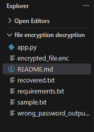
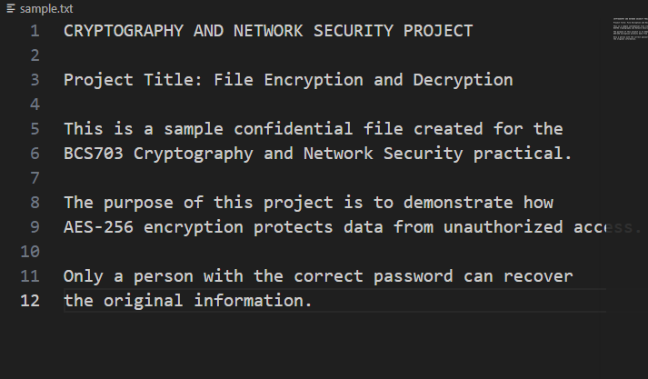
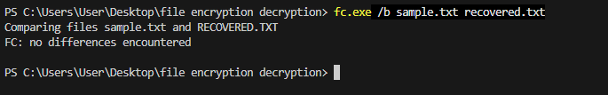
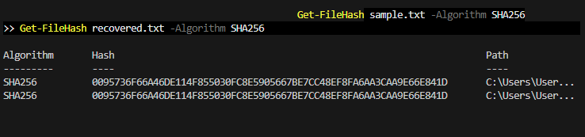
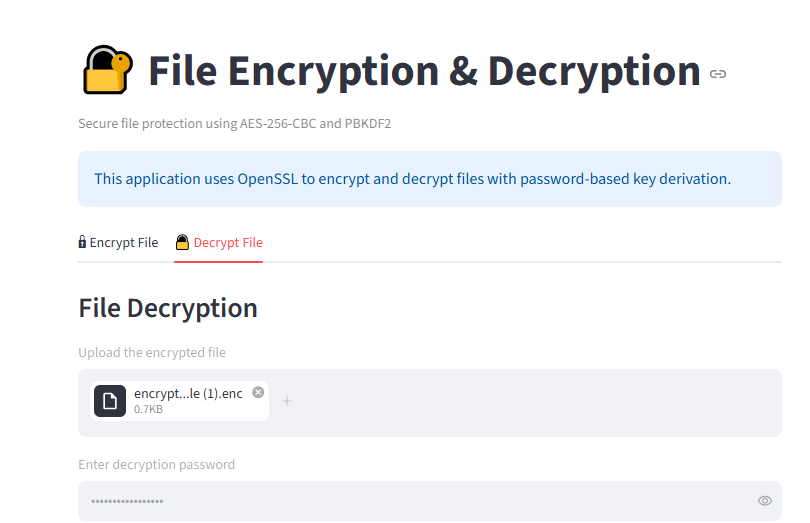
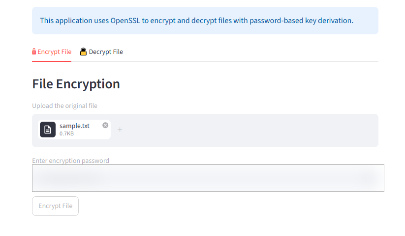

# File Encryption and Decryption Using AES-256

## Project Overview
This project demonstrates secure file encryption and decryption using the AES-256-CBC algorithm with OpenSSL. A Streamlit-based interface allows users to upload files, encrypt them with a password, and decrypt them using the correct password.

## Technologies Used
- Python
- OpenSSL
- AES-256-CBC
- PBKDF2
- Streamlit
- SHA-256

## Features
- Password-based file encryption
- File decryption
- AES-256-CBC encryption
- PBKDF2 key derivation
- SHA-256 hash verification
- Interactive Streamlit interface

## Installation

```bash
pip install -r requirements.txt
```

Install OpenSSL separately and update the executable path in `app.py` if required.

## Run the Application

```bash
streamlit run app.py
```

## Verification
The original file and decrypted file can be compared using SHA-256 hashes to verify that the recovered content matches the original.

## Project Purpose
Developed as part of the BCS703 Cryptography and Network Security experiential learning project.  
## Project Screenshots

### 1. Project Folder Structure


### 2. Original Sample File


### 3. File Comparison Verification


### 4. SHA-256 Hash Verification


### 5. Streamlit Decryption Interface


### 6. Streamlit Encryption Interface


## Verification

The original and decrypted files were verified using SHA-256 hashing and binary file comparison. Both hash values matched, and the comparison reported no differences.